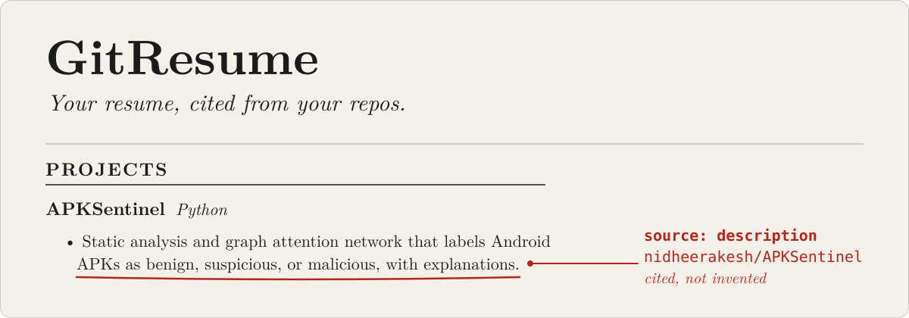
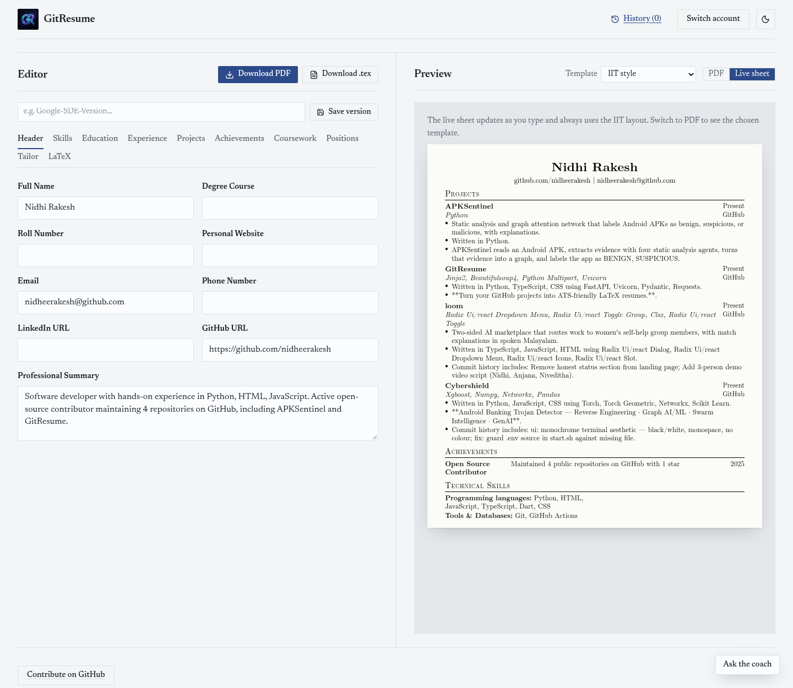
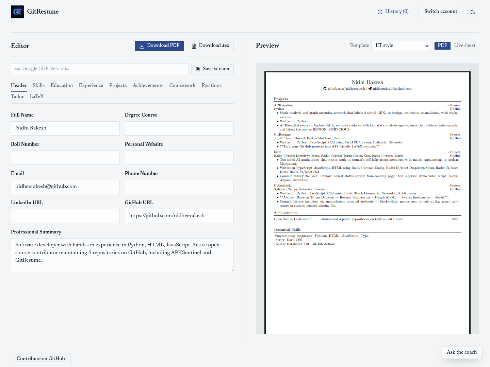
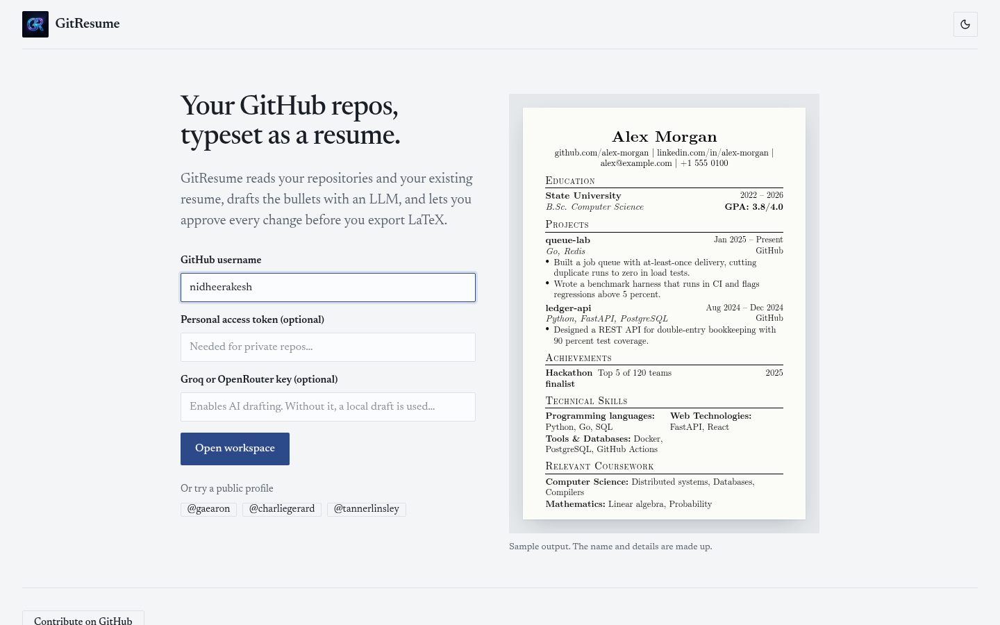
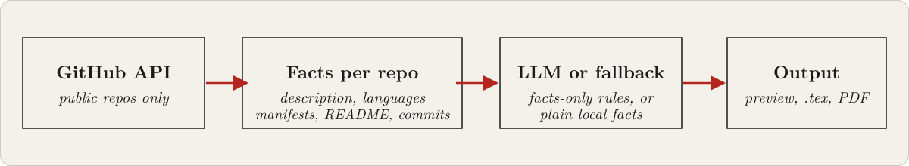

<p align="center">
  
</p>

GitResume turns your public GitHub repositories into an editable resume with four LaTeX templates, a compiled PDF, and `.tex` export. Every bullet is built from facts it found in your repos.

[**Open GitResume**](https://git-resume-two.vercel.app) | [Site](https://nidheerakesh.github.io/GitResume/) | [Guide](https://nidheerakesh.github.io/GitResume/guide/) | [MIT license](LICENSE)

## See the output

Enter a username, pick repos, and get a resume you can edit line by line.



The same resume compiled to PDF with Tectonic:



The first screen is a username, an optional GitHub token, and an optional AI key:



## What it is

- It reads public repo data: descriptions, languages, dependency manifests (`package.json`, `requirements.txt` and similar), the README, and your commit messages. It does not read your source code.
- You choose up to 7 repos, edit every field, hide projects without deleting them, and switch between IIT style, Jake's Resume, Modern minimal, and Compact two-column.
- You can import an existing resume PDF, paste a job description to create a tailored copy (project picks, skill order, keyword check, each reworded bullet marked **Stage** or **Discard**), and save named versions in your browser.
- Output is a Tectonic-compiled PDF, the `.tex` source, or a browser print of the Live sheet (IIT template only).

## How it works



With an AI key, an LLM drafts bullets from those facts. Without one, profile generation falls back to a local facts-only draft: plain statements such as "Written in Python." and the first README sentence. Details are in [How it works](https://nidheerakesh.github.io/GitResume/guide/how-it-works/).

## Quick start

Use the hosted app at <https://git-resume-two.vercel.app>, or run it yourself (Python 3.10+, Node.js 20+).

**Local**

```bash
cd backend
python3 -m venv venv && source venv/bin/activate
pip install -r requirements.txt
python run.py
```

```bash
cd frontend
npm install
npm run dev
```

The backend listens on port 5000 (`/api/health`), the Vite dev server on <http://localhost:5173>.

**Docker**

```bash
docker-compose up --build
```

Frontend on <http://localhost:3000>, backend on <http://localhost:5000>. The image installs Tectonic. For a local run, install [Tectonic](https://tectonic-typesetting.github.io/book/latest/installation/) yourself or set `TECTONIC_BIN`; without it the app shows the Live sheet and browser print instead of a PDF.

## Configuration

Keys are optional. Provider priority is `OPENROUTER_API_KEY` (env), then the key pasted in the UI, then `GROQ_API_KEY`, then `OPENAI_API_KEY`. Other variables: `OPENROUTER_MODEL`, `CUSTOM_API_BASE`, `CUSTOM_API_MODEL`, `CORS_ORIGINS`, `TECTONIC_BIN`, `VITE_API_BASE_URL`. The backend does not load `.env` files. Full table: [docs/configuration.md](docs/configuration.md).

## Limits

- Public repositories only. A GitHub token raises rate limits but does not unlock private repos. Without a token, GitHub allows 60 requests per hour per IP.
- No-key fallback text is plain facts, not polished prose. Importing a PDF, **Build resume**, and the career coach need an AI key; **Use GitHub only** does not.
- AI output is a draft. Check every bullet against what you did.
- LinkedIn scraping is not supported. Export your profile to PDF and import that.
- Keys and tokens travel with requests to the backend, so use a backend you trust.

## Project structure

```text
backend/
  app/        main.py (routes), github.py, ai.py, resume.py, pdf.py, templates/
  tests/      test_fixes.py
  run.py
frontend/src/ App.tsx, api.ts, types.ts, resumeUtils.ts, components/
docs/         guide source
site/         landing page and guide
```

## Contributing and license

See [CONTRIBUTING.md](CONTRIBUTING.md) for setup and checks. More docs: [docs/](docs/README.md). Licensed under [MIT](LICENSE).
