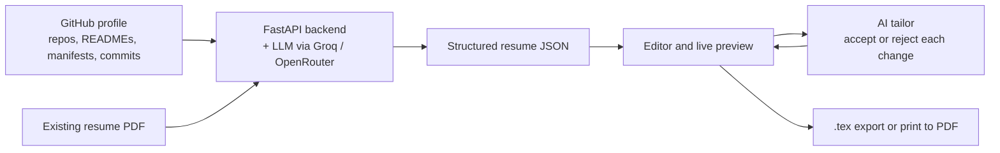

<div align="center">


# GitResume

**Turn your GitHub projects into ATS-friendly LaTeX resumes.**

GitResume reads your public (and, with a token, private) repositories, combines them with your existing resume PDF, and drafts project bullets with an LLM. You review every change, edit the result in a live preview, and export clean `.tex` source.


</div>

---

## How it works



## Features

- **Repository scraping.** Pulls repo metadata, READMEs, dependency manifests (`package.json`, `requirements.txt`, and similar), and your commit messages. A GitHub token also covers private repos.
- **Repo curation.** Search, filter by language, sort, and pick up to 7 repos to feature.
- **Resume PDF import.** Extracts text from an existing resume with `pdfplumber` and parses it into fields. For LinkedIn, use *More → Save to PDF* and upload that file.
- **Synthesis.** Combines GitHub and PDF sources into one draft. A local heuristic fallback still produces a usable draft when no LLM key is set or the API is unavailable.
- **Structured editor.** Edit header, skills, education, experience, projects, achievements, coursework, and positions of responsibility. Hide individual projects without deleting them.
- **AI tailoring.** Paste a job description. The model proposes wording changes, and you accept or reject each one before it applies.
- **Create tailored resume.** Paste a job description and get a new saved version named `Tailored: <role>`. You approve each reworded bullet, relevant projects are picked, skills are reordered, and a keyword check shows what the job asks for. Nothing is invented: only existing content is reordered, selected, or reworded. Your original version is kept.
- **Four LaTeX templates.** IIT style, Jake's Resume, Modern minimal, and Compact two-column. See [Templates](#templates).
- **Real PDF output.** The backend compiles LaTeX to PDF on the server with [Tectonic](https://tectonic-typesetting.github.io/). The preview shows the compiled PDF by default, with a *Live sheet* toggle for the HTML preview.
- **Hand-edited LaTeX.** Edit the generated LaTeX source yourself and compile your version to PDF.
- **Career coach chat.** Ask why a skill or bullet is there, and get answers grounded in the current resume.
- **Export.** Download the compiled `.tex` (editable in the app), or print the preview to an ATS-friendly PDF.
- **Saved versions.** Keep named snapshots in the browser and reload them later.

## Quick start

**Requirements:** Python 3.10+ and Node.js 20+.

### 1. Backend (port 5000)

```bash
cd backend
python3 -m venv venv
source venv/bin/activate        # Windows: venv\Scripts\activate
pip install -r requirements.txt
python run.py
```

Health check: <http://localhost:5000/api/health>

### 2. Frontend (port 5173)

```bash
cd frontend
npm install
npm run dev
```

Open <http://localhost:5173>. On `localhost`, the app calls the backend at `http://localhost:5000/api` automatically.

### PDF engine (Tectonic)

PDF output needs the Tectonic LaTeX engine on the backend machine.

- **Linux:** download the static musl build from the [Tectonic releases page](https://github.com/tectonic-typesetting/tectonic/releases). Use the asset named `tectonic-<version>-x86_64-unknown-linux-musl.tar.gz`, extract it, and put `tectonic` in `~/.local/bin` (make sure that folder is on your `PATH`). The glibc build needs glibc 2.39 or newer, so the musl build is the safe choice on Ubuntu 22.04.
- **macOS:** `brew install tectonic`
- **Windows:** see the [Tectonic install docs](https://tectonic-typesetting.github.io/book/latest/installation/).

The first compile downloads LaTeX packages, which can take a few minutes. Later compiles take a couple of seconds.

The backend looks for Tectonic in this order: the `TECTONIC_BIN` environment variable, then `tectonic` on `PATH`, then `~/.local/bin/tectonic`. Without it, the app falls back to the Live sheet and browser print.

The Docker image installs Tectonic automatically.

### Docker

```bash
docker-compose up --build
```

| Service  | URL                     |
| -------- | ----------------------- |
| Frontend | http://localhost:3000   |
| Backend  | http://localhost:5000   |

## Templates

| ID | Name | Best for |
| --- | --- | --- |
| `iit` | IIT style | Academic one-column layout with roll number, coursework and positions |
| `jakes` | Jake's Resume | Classic one-column ATS layout used by most tech applicants |
| `modern` | Modern minimal | Clean sans-serif one-column layout with a colored accent |
| `twocol` | Compact two-column | Fitting more on one page, with a sidebar for skills and education |

Templates live in `backend/app/templates/<id>.tex.j2`. They are Jinja templates with custom delimiters: `<% %>` for blocks, `<< >>` for variables, and `<# #>` for comments. To add a template, add the file and add an entry to `TEMPLATES` in `backend/app/resume.py`.

Jake's Resume template is based on the MIT-licensed design by Jake Gutierrez.

## API

All routes are under `/api`.

| Method | Path | Purpose |
| --- | --- | --- |
| `GET` | `/api/templates` | List templates, the default template id, and whether PDF output is available |
| `POST` | `/api/resume/compile` | Return LaTeX source for `resume_data`. Takes an optional `template` id |
| `POST` | `/api/resume/pdf` | Compile to PDF. Send `{resume_data, template}` or `{latex}`. Returns `application/pdf` |

`POST /api/resume/pdf` returns:

- `422` on LaTeX errors, with `detail.message` and `detail.log`
- `503` when Tectonic is not installed

## Configuration

Keys are optional. Users can also paste their own keys into the app, and those are sent with each request.

| Variable | Where | Purpose |
| --- | --- | --- |
| `GROQ_API_KEY` | backend | Groq key (`gsk_...`). Default provider. |
| `OPENROUTER_API_KEY` | backend | OpenRouter key (`sk-or-...`). |
| `OPENROUTER_MODEL` | backend | Optional model override for OpenRouter. |
| `OPENAI_API_KEY` | backend | Used when no other key is provided. |
| `CUSTOM_API_BASE`, `CUSTOM_API_MODEL` | backend | Any OpenAI-compatible endpoint. |
| `CORS_ORIGINS` | backend | Comma-separated allowed origins. Defaults to `*`, so set it in production. |
| `VITE_API_BASE_URL` | frontend | Backend base URL. Defaults to `/api` off localhost. |

Copy `backend/.env.example` and `frontend/.env.example` to get started.

## Deployment

- **Vercel (single domain).** `vercel.json` builds the Vite app and serves `backend/app/main.py` at `/api/*`. Add `GROQ_API_KEY` under *Project Settings → Environment Variables*.
- **Render.** `render.yaml` defines a Docker web service for the API and one for the frontend. Set `GROQ_API_KEY` in the dashboard.

## Project structure

```text
GitResume/
├── backend/
│   ├── app/
│   │   ├── main.py        # FastAPI routes and request models
│   │   ├── github.py      # GitHub API client and repo analysis
│   │   ├── ai.py          # LLM prompts, provider routing, local fallback
│   │   └── resume.py      # Resume JSON to LaTeX
│   ├── run.py             # Dev server on port 5000
│   ├── requirements.txt
│   └── Dockerfile
├── frontend/
│   ├── src/
│   │   ├── App.tsx        # App state, API calls, and page layout
│   │   ├── api.ts         # API base URL and error helper
│   │   ├── types.ts       # Resume and GitHub types
│   │   ├── resumeUtils.ts # Normalization and AI diff helpers
│   │   ├── components/    # Login, portal, editor, preview, modals, chat
│   │   ├── index.css      # Design tokens, base styles, print rules
│   │   └── components.css # Component styles
│   └── Dockerfile
├── docker-compose.yml
├── render.yaml
└── vercel.json
```

## Privacy

- The GitHub token is kept in `sessionStorage` (cleared when the tab closes).
- The Groq or OpenRouter key is kept in `localStorage` so you do not have to re-enter it.
- Resume data and saved versions stay in your browser. The backend keeps only an in-memory cache of GitHub lookups for 10 minutes.

## Known limitations

- Direct LinkedIn scraping is often blocked. The PDF export route is more reliable.
- Unauthenticated GitHub API calls have low rate limits. A personal access token raises them.
- The AI output is a draft. Check every bullet against what you actually did.

## Contributing

Issues and pull requests are welcome. Run `npm run build` in `frontend/` before opening a PR.

## License

No license file is included yet. Ask the author before reusing the code.
